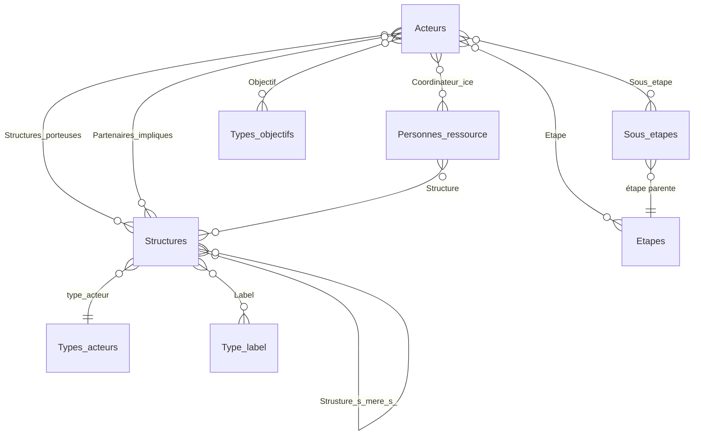

# Schéma de l'annuaire

> Ce schéma décrit la structure de l'annuaire. Il a été établi à partir des champs utilisés pour les imports. Les identifiants marqués *(à confirmer)* doivent être vérifiés dans le modèle `.grist`, qui fait référence.

## Vue d'ensemble

## Tables principales

### Acteurs (un enregistrement par projet)

| Colonne | Type | Description |
|---|---|---|
| `Nom_du_projet` | Texte | Nom du projet |
| `url` | Texte (URL) | Page de présentation du projet |
| `Etape` | Liste de références → `Etapes` | Étape(s) du système alimentaire concernées |
| `Sous_etape` | Liste de références → `Sous_etapes` | Uniquement si une sous-étape correspond |
| `Objectif` | Liste de références → `Types_objectifs` | Objectif(s) poursuivis |
| `Description_acteur` | Texte | 2 à 5 phrases reformulées |
| `Structures_porteuses` | Liste de références → `Structures` | Structures qui pilotent ou mettent en œuvre le projet |
| `Partenaires_impliques` | Liste de références → `Structures` | Financeurs, soutiens et partenaires |
| `Territoire_du_projet` | Texte | Au format « Commune (Département) », ou le niveau le plus précis disponible |
| `Coordinateur_ice` | Liste de références → `Personnes_ressource` | Personnes nommées publiquement comme contact |

### Structures

| Colonne | Type | Description |
|---|---|---|
| `Structure` | Texte | Nom de la structure (libellé de référence) |
| `url` | Texte (URL) | Site web |
| `type_acteur` | Référence → `Types_acteurs` | Statut ou type d'acteur |
| `SIRET` | Texte | 14 chiffres, vérifié sur l'annuaire des entreprises |
| `Label` | Liste de références → `Type_label` | Labels et certifications |
| `Est_un_projet_en_soi` | Booléen | Vrai si la structure figure aussi comme projet dans `Acteurs` |
| `Strusture_s_mere_s_` | Liste de références → `Structures` | Structure(s) mère(s), seulement si le lien est explicite |

### Personnes_ressource

| Colonne | Type | Description |
|---|---|---|
| `Nom` | Texte | |
| `Prenom` | Texte | |
| `Structure` | Liste de références → `Structures` | |
| `adresse_mail` | Texte | Seulement si elle est publiée telle quelle |
| `id2` | Formule | Libellé affiché (calculé, ne pas saisir) |

## Référentiels

Les valeurs sont dans le dossier `referentiels/`.

| Table *(identifiant à confirmer)* | Contenu |
|---|---|
| `Etapes` | Production, Transformation, Distribution, Consommation, Gestion des déchets |
| `Sous_etapes` | Sous-étape et étape parente (ex. Foncier → Production) |
| `Types_objectifs` | Objectif et famille d'objectifs |
| `Types_acteurs` | Association, Collectivité, SCIC, Recherche… |
| `Type_label` | ESS, ESUS, Organisme de formation, Professionnel du Bio… |

## Ordre d'import

`Structures` → `Personnes_ressource` → `Acteurs`. Dans les listes de références, on importe les **libellés exacts**, séparés par des virgules, jamais des identifiants.
